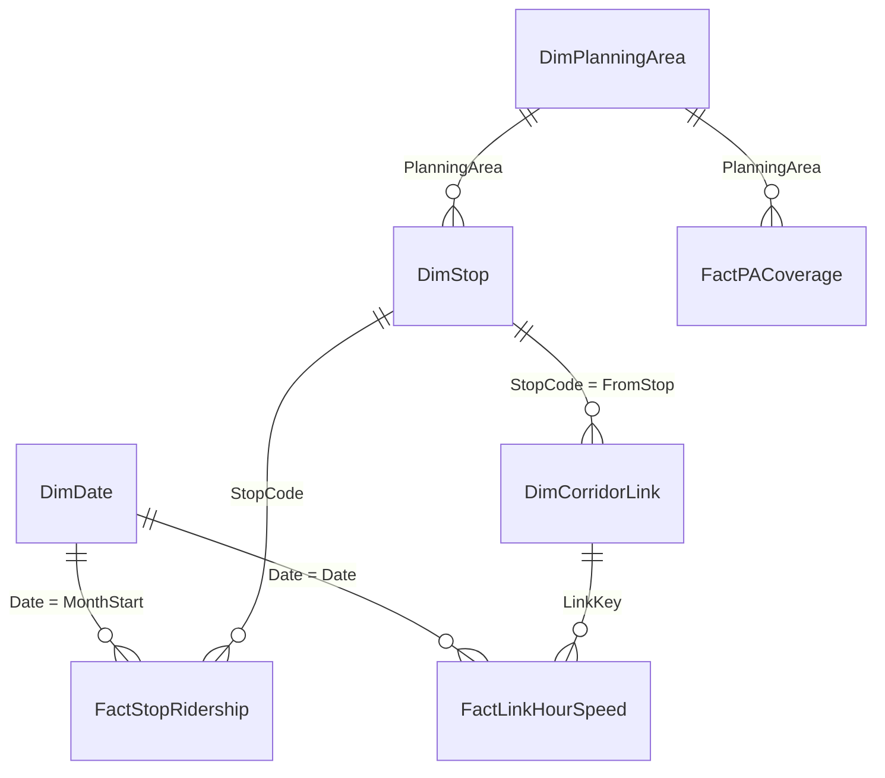

# sg-transport-powerbi

A Power BI report on Singapore's bus network, built from public LTA DataMall, URA and SingStat data. It has
three pages: bus boardings by month, traffic speed on shared bus corridors, and how many residents live within
400 m of a bus stop.

## Status

- The project was **authored as text**, in Microsoft's Power BI Project format (PBIP): the semantic model in
  TMDL and the report in PBIR. It was written without Power BI Desktop, which was not available on the machine
  used.
- **It has not yet been opened or rendered in Power BI Desktop.** Nothing here shows what the pages look like.
  The steps to open it and take screenshots are [below](#open-it-in-power-bi-desktop).
- What has been checked without Desktop:
  - every PBIP/PBIR JSON file validates against Microsoft's published JSON schemas;
  - Microsoft's Tabular Object Model (TOM) library reads the TMDL folder and its model validation reports no
    errors;
  - the value of every DAX measure is recomputed independently in Python from the CSV files and matches, in 62
    filter contexts (286 measure-context pairs);
  - a mutation check plants 30 deliberate bugs, and each one makes a test fail.
- What has not been checked: the Power Query (M) steps have not been run by Power BI; the visuals' layout and
  formatting have not been seen; the DAX has been run by a small Python evaluator written for this project, not
  by the Analysis Services engine.

## Pages

| Page | Shows | Visuals |
|---|---|---|
| Ridership | Bus tap-ins for February, June, July and August 2026, with a month slicer (saved at August) | 5-value card, two column charts by month, bar chart by planning area, top-stops table |
| Corridor speeds | Speed-band speeds on the 303 stop-to-stop links used by 10 or more services, 26 Sep to 3 Oct 2026 | 5-value card, line chart by hour, links table sorted by AM-peak-to-night ratio |
| Walking coverage | Residents within 400 m of a stop, straight line and along the walking network | 3-value card, bar chart and table by planning area |

The ridership page is built around one point from the source project: raw monthly totals mislead when months
have different numbers of weekdays. July 2026 had 23 weekdays and August 20, so weekday tap-ins fell 11.6% from
July to August while tap-ins per weekday rose 1.6% (4.21 M to 4.28 M). The month charts show both.

## Semantic model



All seven relationships are many-to-one with single-direction filtering. `DimDate` is marked as the date table.

| Table | Grain | Rows |
|---|---|---|
| FactStopRidership | stop x month x day type (WEEKDAY, WEEKENDS/HOLIDAY) | 41,426 |
| FactLinkHourSpeed | corridor link x date x hour | 20,907 |
| FactPACoverage | planning area | 42 |
| DimDate | day of 2026, with the DataMall day type from the MOM 2026 public holidays | 365 |
| DimStop | bus stop, with the planning area it lies in | 5,215 |
| DimCorridorLink | directed stop-to-stop link shared by 10+ services | 303 |
| DimPlanningArea | URA Master Plan 2019 planning area, plus two placeholder rows | 57 |

DataMall publishes stop volumes as monthly sums for each day type, not daily counts. That is why the ridership
fact is monthly, and why the per-day measures divide by the number of days of that type in the month.

### Measures

| Measure | What it computes |
|---|---|
| Weekday Boardings | Tap-ins on weekdays |
| Avg Weekday Boardings | Weekday tap-ins / weekdays in the months that have data |
| Avg Weekend/Holiday Boardings | The same for Saturdays, Sundays and public holidays |
| Weekday Boardings MoM % | Change of the raw monthly weekday total against the previous month (`PREVIOUSMONTH`) |
| Avg Weekday Boardings MoM % | Change of tap-ins per weekday against the previous month |
| Mean Speed (km/h) | Mean link speed over all snapshots in the filter context |
| P15 Link-Hour Speed (km/h) | 15th percentile of link-hour mean speeds (`PERCENTILE.INC`) |
| AM Peak Speed (km/h) | Mean speed on weekdays, hours starting 07:00 and 08:00 |
| Night Speed (km/h) | Mean speed, hours starting 22:00 to 04:00 |
| AM Peak / Night Speed | Ratio of the two; lower means a slower peak |
| Total Residents | Residents (GHS 2025) in the planning areas in context |
| Walk Coverage % | Residents within a 400 m walk on the OpenStreetMap network / residents |
| Straight-line Coverage % | Residents within 400 m in a straight line / residents |

The DAX is in [`SGTransport.SemanticModel/definition/tables`](SGTransport.SemanticModel/definition/tables).
Coverage percentages are weighted by residents, not averaged over planning areas.

## Data

The CSV files in [`data/`](data) are small aggregates (about 3 MB in total) exported by
[`scripts/export_data.py`](scripts/export_data.py) from the raw files of
[sg-bus-network-monitor](https://github.com/LUOaini1213/sg-bus-network-monitor) (commit `e20c817`). No row
describes a person. [`data/source_manifest.json`](data/source_manifest.json) records the SHA-256 of every input
and output.

- **Ridership:** LTA DataMall Passenger Volume by Bus Stops for 2026-02, -06, -07 and -08, summed over the hours
  of the day. 14 malformed source rows (out of 812,444) are dropped.
- **Speeds:** 209 LTA DataMall traffic speed-band snapshots, about every 20 minutes from 26 September to
  3 October 2026, with gaps. Speed-band segments are matched to each bus link as in that repository's
  `src/priority.py` (25 m buffer, bearing within 40 degrees, road-name rule; 2,228 matched segments). A
  snapshot's link speed is the length-weighted mean of the band midpoints, kept when matched segments cover at
  least half the link.
- **Coverage:** that repository's `outputs/coverage_walk_planning_area.csv`: GHS 2025 residents placed on URA
  housing parcels, reach measured in a straight line and along the OpenStreetMap walking network.
- **Stops and planning areas:** the DataMall stop list of 26 September 2026, joined to the URA Master Plan 2019
  planning-area polygons (five self-intersecting polygons are repaired first). Four stops are in Johor Bahru and
  six stop codes in the volumes are not in that stop list; they get the placeholder planning areas
  `OUTSIDE SINGAPORE` and `STOP NOT IN SEPT 2026 LIST`.

Limits of the numbers:

- The weekday AM peak in the speed data is a single morning, Monday 28 September 2026. The AM peak measures are
  therefore one morning's figures, not a typical peak.
- Speed bands describe general traffic in 10 km/h bands; the band midpoint is used. They are not bus running
  times, and buses also stop at bus stops.
- The walking-network coverage is a lower bound (OpenStreetMap misses many HDB void-deck shortcuts) and the
  straight-line coverage an upper bound.
- Per-day ridership over several months divides by all the weekdays of those months. A stop that opened during
  that period is therefore averaged over days when it did not exist.
- Ridership is joined to the date table on the first day of each month. Slice it by month (`DimDate[YearMonth]`),
  not by individual dates or by `DimDate[DayType]`.

## How the measures were verified

| Check | What it does | Where |
|---|---|---|
| JSON schema | Validates all 27 PBIP/PBIR JSON files against the schema URL each declares, using a copy of [microsoft/json-schemas](https://github.com/microsoft/json-schemas) at a pinned commit, with its relative `$ref`s resolved | `tools/validate_schemas.py` |
| TMDL | Microsoft.AnalysisServices (TOM) 19.117.0 `TmdlSerializer.DeserializeDatabaseFromFolder`, then `Model.Validate()`; the tables, column types, measure text and relationships TOM sees are compared with the test suite's own TMDL reader | `tools/check_tmdl.ps1`, `tests/test_tom_crosscheck.py` |
| Measures | `pbitest/dax.py` evaluates each measure's DAX text from the TMDL files against the CSVs; `tests/reference.py` computes the same values with pandas on joined tables, without the TMDL or the evaluator. They are compared in 62 filter contexts (286 measure-context pairs): months, planning areas, regions, stops, hours, day types and combinations | `tests/test_measures.py` |
| Published figures | The 23/20 weekdays, 4.21 M and 4.28 M per weekday, -11.6% and +1.6%, and the 98.5% / 96.7% / 79.7% coverage figures reported by sg-bus-network-monitor | `tests/test_published_figures.py` |
| Evaluator | Hand-worked cases on a tiny model: filters through a relationship chain, CALCULATE replacing a filter, `PREVIOUSMONTH` removing other date-table filters, `PERCENTILE.INC`, BLANK rules | `tests/test_dax_engine.py` |
| Report | Every field a visual uses exists in the model and is not hidden; names follow the PBIR rules; the saved slicer value exists; interactions point at real visuals; the JSON is reproduced by its generator | `tests/test_report.py` |
| Mutation | 30 planted bugs (18 in the DAX or relationships, 5 in the evaluator, 2 in the data, 5 in the report), each run against the tests meant to catch it. Two controls run first: the unmodified copy passes and a harmless edit survives | `tests/mutate.py` |

The evaluator covers only the DAX used here (CALCULATE with column filters, PREVIOUSMONTH, SUM, COUNTROWS,
DIVIDE, PERCENTILE.INC, VAR/RETURN, IF, ISBLANK) and raises an error on anything else. Its semantics are
written from the DAX documentation; where it and the Analysis Services engine differ, Power BI Desktop is right.
[`expected/visual_values.csv`](expected/visual_values.csv) lists what every card, chart and table should show
(281 values), worked out from the report files and the evaluator, for comparison once the report is open.

## Open it in Power BI Desktop

Power BI Desktop runs on Windows 10 or 11 and is free.

1. Install **Power BI Desktop** from the Microsoft Store (search "Power BI Desktop", publisher Microsoft
   Corporation). It can be used without signing in; close the sign-in prompt if one appears.
2. Get the files: `git clone https://github.com/LUOaini1213/sg-transport-powerbi.git C:\src\sg-transport-powerbi`,
   or download the ZIP from GitHub and extract it to a short path such as `C:\src\sg-transport-powerbi`.
3. Only if step 4 reports that the project format is not supported: open **File > Options and settings >
   Options > Preview features**, tick the options that mention Power BI Project (.pbip), TMDL or PBIR, restart
   Desktop and try again. Recent versions support these formats without preview settings.
4. **File > Open > Browse**, choose `C:\src\sg-transport-powerbi\SGTransport.pbip`.
   - If an error dialog appears, copy its full text (it names the file and line) and stop here.
5. The project has no saved data, so the model opens empty. Click **Home > Refresh**.
   - The tables load from the CSV files on GitHub (`raw.githubusercontent.com`). If Desktop asks how to connect,
     choose **Anonymous** and **Connect**.
   - To load the local files instead: **Home > Transform data > Edit parameters**, set `DataFolder` to
     `C:\src\sg-transport-powerbi\data\` (with the trailing backslash), **OK**, then **Apply changes**.
6. Check the numbers. On the Ridership page, with the month slicer at 2026-08, the card should show
   Avg Weekday Boardings 4,278,653, Avg Weekday Boardings MoM % +1.6%, Weekday Boardings 85,573,057,
   Weekday Boardings MoM % -11.6% and Avg Weekend/Holiday Boardings 3,394,639. Every other card, chart and table
   is listed in `expected/visual_values.csv`.
7. Check **Model view** (the third icon on the left): seven relationships, as in the diagram above.
8. Take the screenshots listed below: open each page, press **Win+Shift+S**, select the report canvas, and save
   the image from the notification into `docs/screenshots/` with the file name given.
9. Close Desktop. Saving is optional. Desktop's save rewrites the PBIR and TMDL files in its own style (for
   example it adds lineage tags), after which `tools/build_report.py` no longer reproduces them and
   `test_generator_reproduces_committed_files` fails until the generator is retired. Commit a Desktop save
   separately from any other change.

## Screenshots

Not taken yet. To be added from Power BI Desktop (step 8 above):

| File | Content |
|---|---|
| `docs/screenshots/01-ridership.png` | Ridership page, slicer at 2026-08 |
| `docs/screenshots/02-corridor-speeds.png` | Corridor speeds page |
| `docs/screenshots/03-walking-coverage.png` | Walking coverage page |
| `docs/screenshots/04-model-view.png` | Model view with the seven relationships |

## Repository layout

```text
SGTransport.pbip                     project file; open this in Power BI Desktop
SGTransport.SemanticModel/           semantic model: definition.pbism, definition/*.tmdl (TMDL)
SGTransport.Report/                  report: definition.pbir, definition/ (PBIR pages and visuals), base theme
data/                                CSV extracts and source manifest
expected/visual_values.csv           what each visual should show
scripts/export_data.py               builds data/ from sg-bus-network-monitor's raw files
tools/build_report.py                writes the PBIR files from a compact layout
tools/validate_schemas.py            JSON schema validation; tools/fetch_schemas.sh fetches the schemas
tools/check_tmdl.ps1                 TOM parse and validation of the TMDL folder
tools/expected_values.py             writes expected/visual_values.csv
pbitest/                             TMDL reader, CSV loader and DAX evaluator used by the tests
tests/                               pytest suite, pandas reference, mutation check
```

## Run the checks

```bash
pip install -r requirements.txt
bash tools/fetch_schemas.sh                 # Microsoft's JSON schemas at a pinned commit, into .schemas/
python tools/validate_schemas.py
pwsh tools/check_tmdl.ps1                   # PowerShell 7; downloads the TOM NuGet package into .tom/
python -m pytest -q
python tests/mutate.py
```

To rebuild the data (needs a checkout of sg-bus-network-monitor with its raw DataMall files):

```bash
pip install -r requirements-export.txt
python scripts/export_data.py --bus-repo ../sg-bus-network-monitor
python tools/expected_values.py
```

CI runs the schema validation, the tests and the mutation check on Ubuntu, and the TOM check on Windows.

## Sources and licences

- LTA DataMall: Passenger Volume by Bus Stops, Bus Stops, Traffic Speed Bands (Singapore Open Data Licence).
- URA Master Plan 2019 planning area boundaries; SingStat General Household Survey 2025 (data.gov.sg,
  Singapore Open Data Licence).
- Walking network: OpenStreetMap contributors (ODbL); only planning-area totals derived from it are included.
- MOM public holidays 2026.
- `SGTransport.Report/StaticResources/SharedResources/BaseThemes/CY24SU10.json` is Microsoft's Power BI base
  theme, copied from [microsoft/fabric-toolbox](https://github.com/microsoft/fabric-toolbox) (MIT), with the
  style entry for one unused map visual removed.

The code is under the MIT licence.
